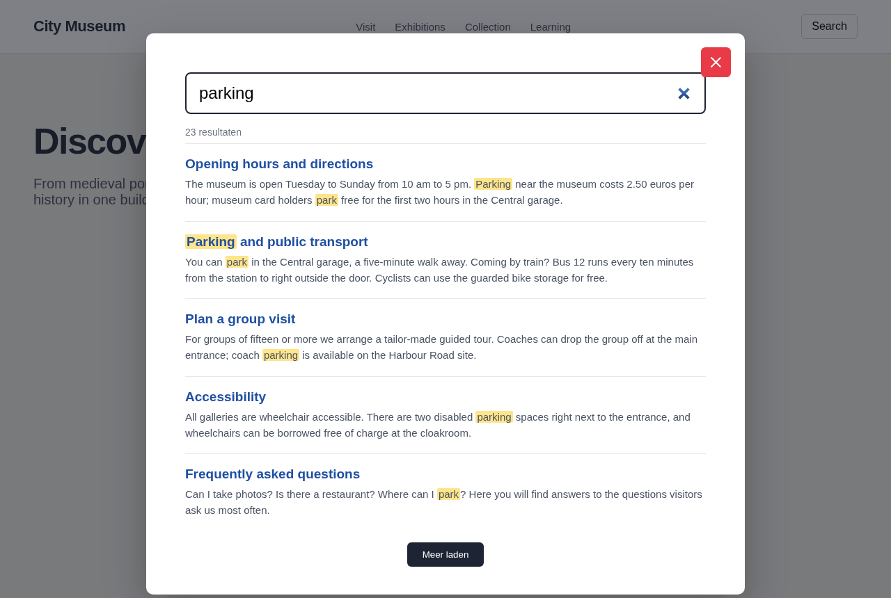

# Silverstripe Typesense

Full-page [Typesense](https://typesense.org) search for Silverstripe CMS 5. The module indexes each page **as a visitor sees it**, so content from elements, blocks and templates is searchable too, not only the `Content` field. It also ships an instant-search overlay that shows results while you type.

It is built on top of [elliotsawyer/silverstripe-typesense](https://codeberg.org/0x/silverstripe-typesense), which provides the Typesense client, the collection models and the CMS admin.

<!-- TODO: add screenshot docs/en/images/overlay.png -->
<!--  -->

## How this differs from elliotsawyer/silverstripe-typesense

| | elliotsawyer/silverstripe-typesense | This module |
|---|---|---|
| What gets indexed | Database fields you configure per collection | The rendered page as plain text (`FullPage`), plus `Title` and `URL` |
| Keeping the index up to date | Sync task / queued jobs | Automatic upsert on publish, delete on unpublish or when *Show in search* is off, plus its own sync task |
| Frontend | None | Instant-search overlay (InstantSearch.js), `?q=` in the URL with back-button support, GA4 / Tag Manager / Matomo events |
| Local development | — | `_local` collection suffix so local and production indexes don't mix |

The admin for collections, fields and synonyms is still the one from Elliot Sawyer's module. This module turns his sync task off and replaces it with `TypesenseSyncTaskHmk`.

## Requirements

- PHP 8.0+
- Silverstripe CMS 5
- A running Typesense server
- jQuery and the Bootstrap `d-none` utility class on the frontend (used by the overlay, see [Frontend search](docs/en/frontend.md#known-limitations))

## Installation

```shell
composer require hamaka/silverstripe-typesense
```

Then run `vendor/bin/sake dev/build flush=1`.

## Quick start

1. Add the environment variables to your `.env`:

   ```bash
   TYPESENSE_API_KEY="your-admin-api-key"
   TYPESENSE_SERVER="https://typesense.example.com:443"
   TYPESENSE_SEARCH_KEY="your-search-only-api-key"
   ```

2. Define a collection: copy [`_config/typesense.yml.example`](_config/typesense.yml.example) to `app/_config/typesense.yml` and give it a unique name.

3. Build the index:

   ```shell
   vendor/bin/sake dev/tasks/TypesenseSyncTaskHmk
   ```

4. Add the overlay to your template and load the script:

   ```html
   <% include TypesenseSearchOverlay %>
   <button class="js-search-open">Search</button>

   <script src="$resourceURL('hamaka/silverstripe-typesense:client/dist/javascript/bundle.js')"></script>
   <script>
     document.addEventListener('DOMContentLoaded', () => {
       new TypesenseInstantSearch({ indexName: 'your-collection' });
     });
   </script>
   ```

From then on, every publish updates the index.

## Documentation

- [How it works](docs/en/how-it-works.md): how pages are rendered and turned into searchable text
- [Configuration](docs/en/configuration.md): environment variables, collections, DOM clean-up
- [Frontend search](docs/en/frontend.md): the overlay, JavaScript usage, analytics, known limitations
- [Development](docs/en/development.md): building the JavaScript bundle, releases

## Changelog

See [Releases](../../releases) for the changes in each version.

## Credits and license

This module is released under the [MIT license](LICENSE).

It depends on [elliotsawyer/silverstripe-typesense](https://codeberg.org/0x/silverstripe-typesense) by Elliot Sawyer, licensed under LGPL-3.0 with attribution. `src/Tasks/TypesenseSyncTask.php` is derived from that module's sync task and keeps its original copyright header.
